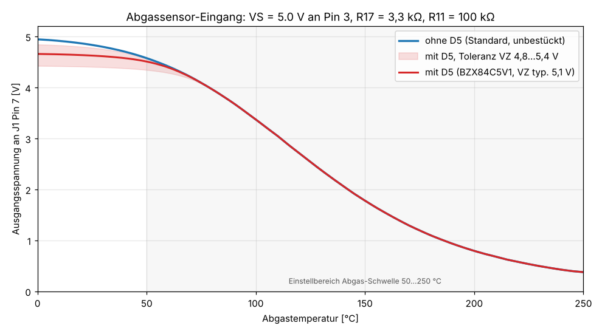
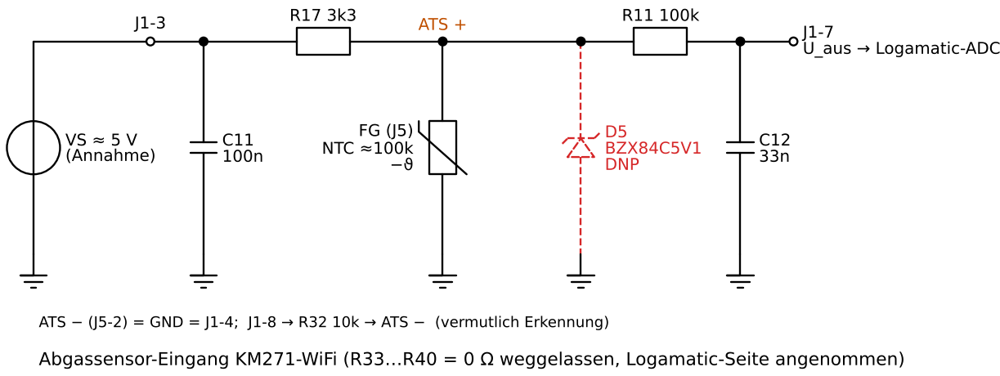
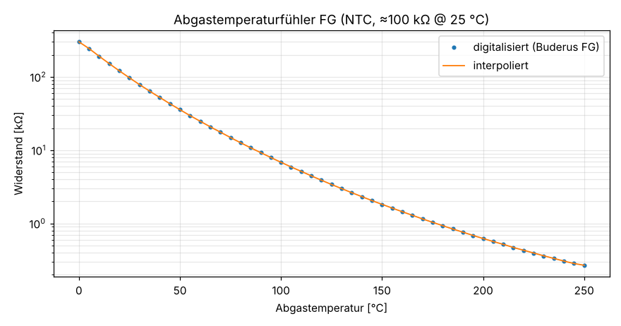
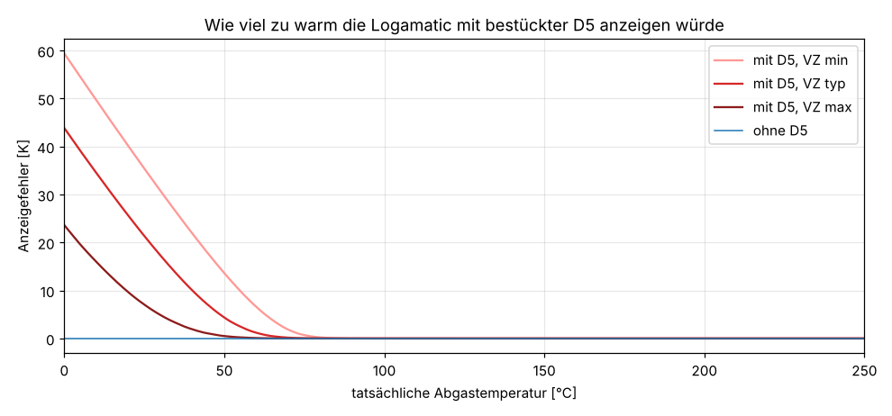
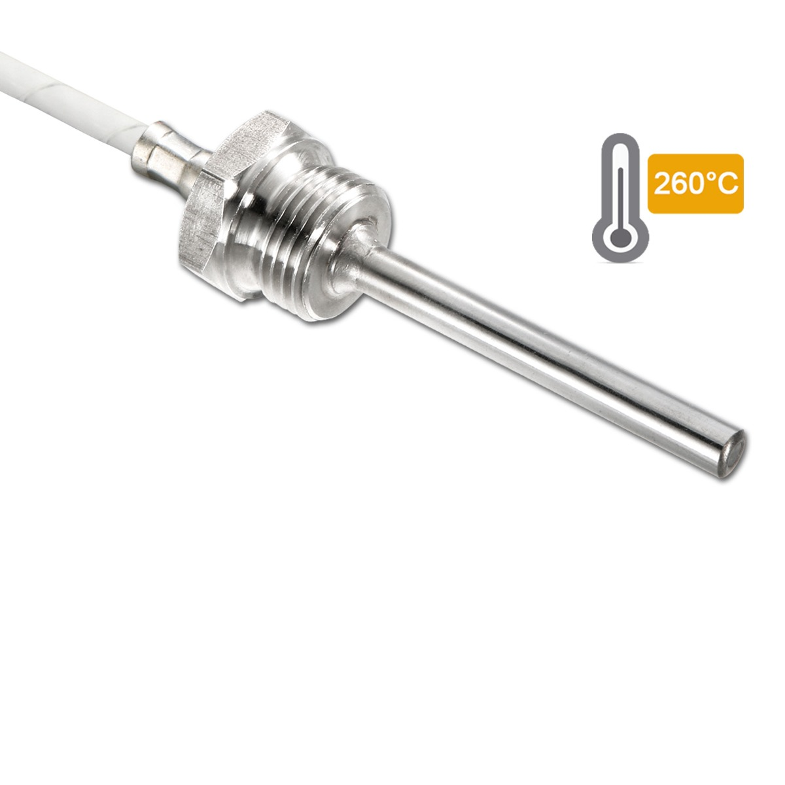

# Abgastemperatursensor: Ausgangsspannung über Temperatur, mit und ohne D5

Stand: 2026-11-17. Skripte: [`abgas.py`](abgas.py) (Berechnung und Plots), [`schematic.py`](schematic.py) (Schaltplan).

## Ergebnis in Kürze

- **Ohne D5 (Standard)** fällt die Spannung an J1 Pin 7 monoton von 4,95 V bei 0 °C auf 0,38 V bei 250 °C. Die steilste Stelle liegt bei etwa 100…150 °C, also mitten im Einstellbereich der Abgasschwelle (50…250 °C).
- **Mit D5 (BZX84C5V1)** wird die Spannung unterhalb von etwa **80 °C** nach unten gezogen. Die Zenerdiode leitet mit ihrer weichen Kennlinie schon ab etwa 4 V merklich, und R17 (3,3 kΩ) begrenzt den Strom kaum. Die Logamatic würde dann zu hohe Abgastemperaturen anzeigen: typisch +4 K bei 50 °C, +21 K bei 25 °C und +44 K bei 0 °C, je nach Exemplar (VZ 4,8…5,4 V) bis zu +60 K.
- **Ab etwa 80 °C** haben beide Varianten dieselbe Kurve, die Diode ist dort wirkungslos. Das bestätigt die Notiz im Schaltplan: *„Do not populate D5 to allow temperatures < 80 °C to be recognized.“*



## Schaltung



| Bauteil | Wert | Netz |
|---|---|---|
| R17 | 3,3 kΩ | J1-3 (über R35 0 Ω) → ATS+ |
| R11 | 100 kΩ | ATS+ → J1-7 (über R39 0 Ω) |
| C11 | 100 nF | J1-3-Seite → ATS− |
| C12 | 33 nF | J1-7-Seite → ATS− |
| R32 | 10 kΩ | J1-8 (über R40 0 Ω) → ATS− |
| ATS− | – | J1-4 (über R36 0 Ω) |
| D5 | BZX84C5V1, **DNP** | ATS+ (K) → ATS− (A) |
| FG | Buderus-Abgasfühler, NTC | J5 |

**Annahmen zur Logamatic-Seite.** Buderus dokumentiert die Belegung nicht, deshalb ist sie aus der Beschaltung abgeleitet:

- **J1-3** speist den Teiler mit VS ≈ 5 V. Das passt zu R17 = 3,3 kΩ: Bei etwa 125 °C ist R_NTC ≈ R17, die Spannung liegt dann bei VS/2, also mitten im Messbereich.
- **J1-7** ist der hochohmige Messeingang (ADC). R11 und C12 bilden einen Eingangsfilter (τ ≈ 3,3 ms) und begrenzen den Strom.
- **J1-4** ist die Bezugsmasse des Fühlers. **J1-8** mit R32 dient vermutlich zur Modul- oder Fühlererkennung und spielt für die Kennlinie keine Rolle.

Mit dieser Annahme passt die Simulation zur Schaltplannotiz („< 80 °C“). Hängt an Pin 3 eine andere Spannung, verschiebt sich die Kurve. `VS` und `RIN` stehen oben in `abgas.py`.

## Fühlerkennlinie (FG)

Die Kennlinie ist aus der Buderus-Serviceanleitung Logamatic 2107 (6302 0501, Abschnitt 18 „Fühlerkennlinien“, S. 51) digitalisiert. Werte in 5-K-Schritten stehen in [`fg_kennlinie.csv`](fg_kennlinie.csv). Es ist ein NTC mit etwa 100 kΩ bei 25 °C und einem B-Wert von etwa 4000…4100 K. Buderus schreibt dazu, die Kennlinien seien Mittelwerte mit Toleranzen.



## Werte

| T [°C] | R_NTC [kΩ] | U ohne D5 [V] | U mit D5, VZ min/typ/max [V] | Anzeigefehler typ. [K] |
|---|---|---|---|---|
| 0 | 301 | 4,945 | 4,42 / 4,66 / 4,85 | +44 |
| 25 | 97,3 | 4,835 | 4,41 / 4,63 / 4,78 | +21 |
| 40 | 52,5 | 4,704 | 4,38 / 4,58 / 4,68 | +10 |
| 50 | 35,7 | 4,576 | 4,34 / 4,51 / 4,57 | +4,4 |
| 60 | 24,8 | 4,413 | 4,28 / 4,39 / 4,41 | +1,2 |
| 70 | 17,6 | 4,211 | 4,17 / 4,21 / 4,21 | +0,2 |
| 80 | 12,6 | 3,964 | 3,96 (alle) | 0 |
| 100 | 6,84 | 3,372 | gleich | 0 |
| 150 | 1,82 | 1,779 | gleich | 0 |
| 200 | 0,62 | 0,794 | gleich | 0 |
| 250 | 0,27 | 0,377 | gleich | 0 |

Bei 250 °C fließen durch R17 und den Fühler etwa 1,4 mA. Das sind rund 0,5 mW im Fühler, die Eigenerwärmung ist damit vernachlässigbar.

## Anzeigefehler durch D5

Der Fehler ist berechnet als die Temperatur, die eine auf die Kurve ohne D5 kalibrierte Logamatic aus der Spannung mit D5 ermitteln würde, minus der tatsächlichen Temperatur.



## Vergleich mit dem 100k-NTC von sensorshop24

**Passender Fühler:** [Einschraubtemperaturfühler mit G1/4"-Gewinde](https://www.sensorshop24.de/temperaturfuehler-passiv/einschraubtemperaturfuehler-mit-g1-4-gewinde), Artikel-Nr. `EF-3-EF3T-NTC100k-2L-2.0-50` (Stand 2026-11-17: 17,05 € netto, 20,29 € brutto). Diese Optionen müssen ausgewählt werden:

| Option | Auswahl |
|---|---|
| Leitungsmaterial | PFA (hitzebeständig) |
| Sensor | NTC 100 kΩ |
| Schaltungsart | 2-Draht |
| Kabellänge PFA 2-Leiter | 2 m |
| Einbaulänge | 50 mm |
| Schutzart | IP54 |

Fühler bis 260 °C einsetzbar (Herstellerangabe), also oberhalb der Abgasschwelle von maximal 250 °C.

<br>
<sub>Bild: sensorshop24</sub>

Tabelle: [sensorshop24 NTC 100k](https://www.sensorshop24.de/kennlinien/ntc-100k-tabelle), übernommen in [`ntc100k_sensorshop24.csv`](ntc100k_sensorshop24.csv) (10-K-Schritte bis 160 °C, danach nur noch 250 °C). Die Spalte „Anzeige“ ist die Temperatur, die eine Logamatic mit FG-Kennlinie aus dem Widerstand des sensorshop24-Fühlers ermitteln würde.

| T [°C] | R sensorshop24 [kΩ] | R FG [kΩ] | Anzeigefehler [K] |
|---|---|---|---|
| 25 | 100,0 | 97,3 | −0,6 |
| 50 | 35,56 | 35,69 | +0,1 |
| 80 | 12,41 | 12,64 | +0,6 |
| 100 | 6,66 | 6,84 | +0,9 |
| 120 | 3,79 | 3,89 | +1,0 |
| 150 | 1,78 | 1,82 | +1,0 |
| 160 | 1,42 | 1,45 | +0,8 |
| 250 | 0,26 | 0,27 | 0,0 |

Laut den Tabellen passen beide Kennlinien bis 250 °C auf etwa ±1 K (B25/100 ≈ 4019 K, B25/250 ≈ 4126 K beim sensorshop24-Fühler). Zwischen 160 und 250 °C hat die sensorshop24-Tabelle keine Stützstellen, dort ist nur interpoliert. Eine Abweichung von 10…20 K in der Praxis lässt sich aus den Nennkennlinien nicht erklären. Wahrscheinlicher sind Einbau und Wärmeankopplung im Abgasrohr, die Exemplarstreuung (B-Toleranz wirkt bei hohen Temperaturen am stärksten) oder die Umrechnung in der Logamatic.

## Modell und Grenzen

- **Statische Rechnung (DC).** C11/C12 spielen für die Kennlinie keine Rolle. Gelöst wird der Knoten ATS+ numerisch (Bisektion).
- **Zenerdiode BZX84C5V1:** VZ = 4,8 / 5,1 / 5,4 V bei 5 mA (min/typ/max laut Datenblatt). Die weiche Kennlinie unterhalb des Knies ist exponentiell modelliert, mit 109 mV pro Faktor e (etwa 50 µA bei VZ − 0,5 V, etwa 1 µA bei VZ − 0,9 V). Reale Exemplare streuen im µA-Bereich stark, die Toleranzkurven zeigen die Größenordnung.
- **Kennlinie des Fühlers** aus einer gedruckten Grafik digitalisiert, Genauigkeit etwa ±2 K.
- Der ADC-Eingang der Logamatic ist als hochohmig (1 GΩ) angenommen.

## Reproduzieren

```bash
pip install numpy matplotlib schemdraw
python3 abgas.py        # Plots + Wertetabelle
python3 schematic.py    # schematic_abgas.svg/.png (nutzt die IEC-Symbole aus ../Power-Analysis/schematics.py)
```
