# Versorgung aus der Buderus-Logamatic: LDO (alt) vs. Buck (neu)

Stand: 2026-11-17. Simulation mit ngspice und Verhaltensmodellen, Skript: [`sim.py`](sim.py).

## Ergebnis in Kürze

- **Bei Ri = 1 Ω reicht es mit beiden Schaltungen.** Der alte AZ1117-LDO hält +3V3 bei einem 300-mA-Sprung (60 → 360 mA). Sein Eingang fällt auf 4,64 V, die Grenze, ab der der LDO aus der Regelung fällt, liegt bei etwa 4,39 V. +3V3 bricht nur kurz um etwa 60 mV ein. Zum Brown-out (~2,43 V) fehlen fast 0,8 V.
- **Das alte Design hat aber wenig Reserve.** Ab etwa **1,8 Ω** fällt der LDO aus der Regelung, und +3V3 sinkt linear mit Ri. Unter 3,0 V (ESP32-Minimum) geht es ab etwa **2,5 Ω**, der Brown-out wird bei etwa **4 Ω** erreicht.
- **Der Buck (TPS62162 hinter D9) ist deutlich robuster.** Er regelt bis etwa **3 Ω** sauber auf 3,30 V, fällt erst ab etwa 4,2 Ω unter 3,0 V und erreicht bis 6 Ω keinen Brown-out. Der Einbruch am Lastsprung beträgt nur etwa 5 mV.
- **Der Buck zieht weniger Strom aus der Buderus:** 292 mA statt 365 mA bei 360 mA Last an +3V3. Dadurch fällt auch an Ri weniger ab, obwohl D9 zusätzlich etwa 0,38 V kostet.

Die Vermutung, dass 1 Ω allein den ESP32 an den Brown-out bringt, bestätigt die Simulation also **nicht**. Damit Nutzer mit dem alten Board Resets sehen, muss die effektive Quellimpedanz zeitweise deutlich größer sein (≥ 2…4 Ω) oder die Leerlaufspannung niedriger. Mögliche Ursachen siehe [Diskussion](#diskussion).

## Modell

**Alt** (bis v0.1.0)

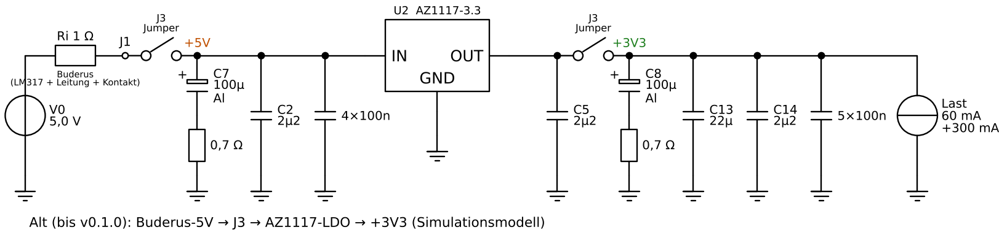

**Neu** (S3-Stand)

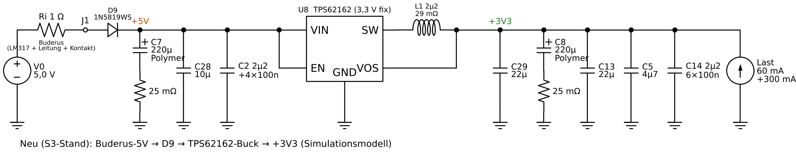

Die Schaltpläne zeigen die simulierten Netzwerke. Die 100-nF-Kondensatoren sind zusammengefasst, und D10 (SMAJ5.0A) ist weggelassen. Vektorversionen: [schematic_ldo.svg](schematic_ldo.svg), [schematic_buck.svg](schematic_buck.svg).

| Größe | Wert | Herkunft |
|---|---|---|
| V0 | 5,0 V | gemessen 5,0…5,1 V am Board ([dewenni#57](https://github.com/dewenni/ESP_Buderus_KM271/issues/57)) |
| Ri | 1 Ω (Sweep 0,5…6 Ω) | Annahme, umfasst Regler, Leitungen, Steckkontakt |
| Last | Stromquelle an +3V3, 60 mA Grundlast, +300 mA Sprung von 1 bis 6 ms, Flanke 1 µs | entspricht grob WLAN-TX-Bursts |
| Brown-out | ~2,43 V (ESP32 Level 0) / ~2,44 V (ESP32-S3 Level 7) | ESP-IDF |
| ESP32-Minimum | 3,0 V | WROOM-Datenblatt |

**Alt** (Schaltplan `main`, KM217-WiFi.kicad_sch):

| Netz | Bauteile im Modell |
|---|---|
| +5V | C7 100 µ/16 V Al-Elko (ESR 0,7 Ω angenommen), C2 2u2 (≈1,6 µ bei 5 V), C3/C10/C20/C24 100 n |
| LDO | AZ1117-3.3: Dropout 1,0 V + 0,25 Ω·I (≈1,09 V bei 360 mA), Iq 5 mA, Fehlerverstärker 66 dB, Pol 50 Hz |
| +3V3 | C8 100 µ/16 V Al-Elko (ESR 0,7 Ω), C13 22 µ (≈18 µ), C5 2u2, C14 2u2, 5× 100 n |

**Neu** (Stand `km271-s3/swap-1117`, ESP32-S3):

| Netz | Bauteile im Modell |
|---|---|
| Eingang | D9 1N5819WS (Vf ≈ 0,27 V bei 60 mA, ≈ 0,38 V bei 290 mA), D10 SMAJ5.0A nicht modelliert |
| +5V | C7 220 µ/16 V Polymer (ESR 25 mΩ), C28 10 µ/25 V 0805 (≈6,5 µ bei 5 V), C2 2u2, 4× 100 n |
| Buck | TPS62162, gemitteltes Modell mit Strom-Innenschleife (~200 kHz) und PI-Spannungsregler (~30 kHz), 100-%-Modus, RDS(on),HS ≈ 0,42 Ω, L1 2,2 µH / 29 mΩ |
| +3V3 | C8 220 µ Polymer (ESR 25 mΩ), C29 + C13 22 µ 0805 (je ≈11 µ), C5 4u7, C14 2u2, 6× 100 n |

U2 (AZ1117) und R79 sind im neuen Stand DNP und nicht modelliert.

## Alt: AZ1117-LDO bei Ri = 1 Ω

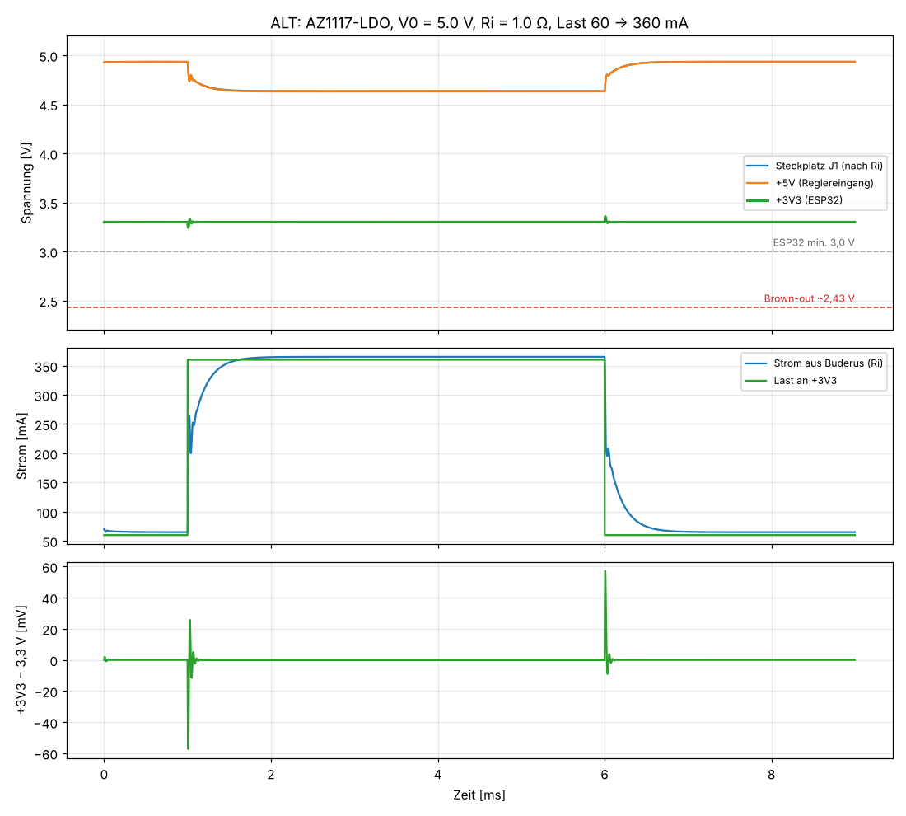

- Steckplatz/+5V: 4,94 V → **4,64 V** (360 mA aus der Buderus, inkl. 5 mA Iq)
- +3V3: Minimum **3,24 V** (kurz nach der Flanke), danach wieder 3,30 V
- Die Zeitkonstante am Eingang (Ri · C7 ≈ 100 µs plus ESR) sieht man im Strom aus der Buderus: C7 liefert die ersten ~0,5 ms mit.

## Neu: D9 + TPS62162 bei Ri = 1 Ω

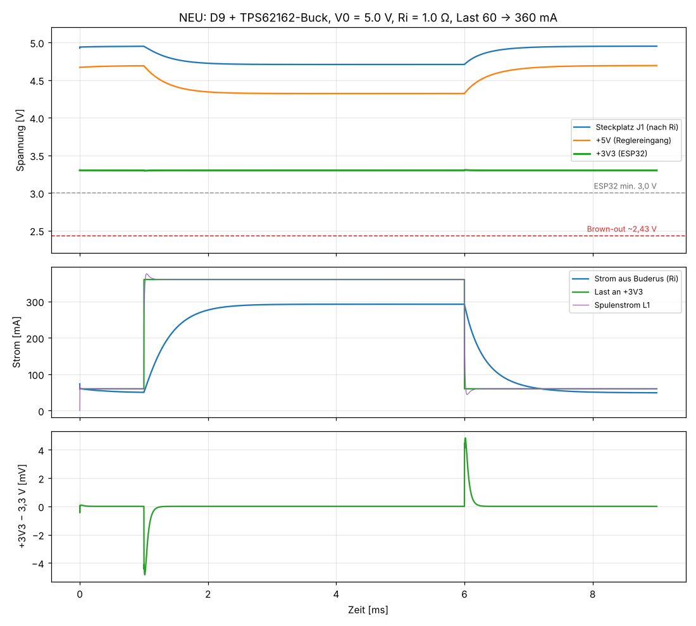

- Steckplatz: 4,95 V → **4,71 V**, +5V hinter D9: 4,69 V → **4,32 V**
- Strom aus der Buderus: **292 mA** bei 360 mA an +3V3 (Wirkungsgrad im Modell: Buck ≈ 94 %, inklusive D9 ≈ 86 %)
- +3V3: Einbruch **< 5 mV**. Die 220-µF-Polymer-Elkos glätten den Sprung fast vollständig.

## Flanken im Detail

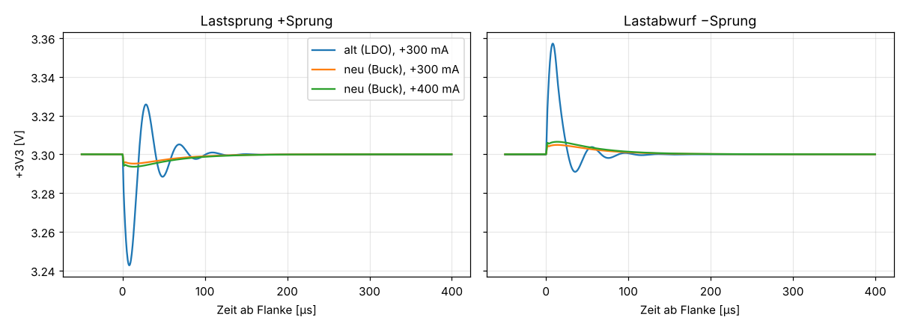

Das Überschwingen des LDO stammt zum Teil vom einfachen Regelkreismodell. Die Größenordnung (einige 10 mV mit 100-µF-Al-Elko) passt aber zu typischen 1117-Datenblattkurven.

## Empfindlichkeit gegenüber Ri

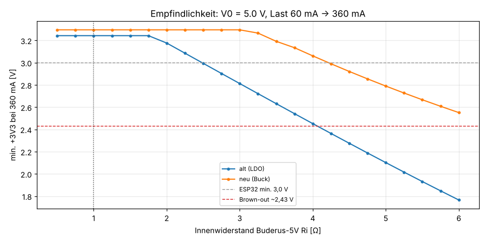

| Ri | min. +3V3 alt (LDO) | min. +3V3 neu (Buck) |
|---|---|---|
| 1,0 Ω | 3,24 V | 3,30 V |
| 2,0 Ω | 3,18 V | 3,30 V |
| 3,0 Ω | 2,81 V | 3,30 V |
| 4,0 Ω | 2,45 V (Brown-out-Grenze) | 3,06 V |
| 5,0 Ω | 2,10 V | 2,79 V |
| 6,0 Ω | 1,77 V | 2,55 V |

Faustformel alt: Der LDO regelt, solange `V0 − Ri·I ≥ 3,3 V + 1,0 V + 0,25 Ω·I`. Bei 360 mA heißt das Ri ≤ (5,0 − 4,39) / 0,365 ≈ 1,7 Ω.

## Diskussion

Warum sehen dann manche Nutzer Brown-outs mit dem alten Board?

1. **Ri ist nicht konstant.** Wenn der LM317 auf der Netz-/Relaiskarte NM 282 selbst aus der Regelung fällt, etwa durch 100-Hz-Welligkeit am Ladeelko, schwachen Trafo oder gealterten Elko, steigt die effektive Impedanz schlagartig. Das passiert genau in den Wellentälern.
2. **V0 streut.** LM317-Toleranz, Spannungsteiler und Netzspannung. Mit V0 = 4,8 V sinkt die Grenze für das alte Design schon auf etwa 1,1 Ω.
3. **Größere Spitzen.** Die RF-Kalibrierung beim Booten des ESP32 zieht kurzzeitig bis ~500 mA. Das verschiebt die Ri-Grenze nach unten.
4. **Kontakt am Steckplatz.** Ein oxidierter Platinenstecker kann einige 100 mΩ bis Ω beitragen. [dewenni#99](https://github.com/dewenni/ESP_Buderus_KM271/issues/99) berichtet, dass erneutes Einstecken geholfen hat.
5. **Gemessene Spitzen von mehreren 100 mV** ([dewenni#57](https://github.com/dewenni/ESP_Buderus_KM271/issues/57)) passen zu Ri ≈ 1…2 Ω bei WLAN-Bursts. Die LEDs (680 Ω an 3V3, ~2 mA) können sie nicht erklären.

Der Buck ist auch gegen diese Effekte die bessere Wahl: weniger Eingangsstrom und etwa 0,5 V mehr Spannungsreserve am Steckplatz. Er regelt bis etwa 3,5 V am Eingang, also etwa 3,85 V am Steckplatz inklusive D9, während der LDO 4,39 V braucht. Mit ≈15 Ω Eingangsimpedanz (V²/P) liegt er weit über der Quelle, das Middlebrook-Kriterium ist erfüllt.

## Grenzen des Modells

- Verhaltensmodelle, keine Herstellermodelle. Es gibt keine Schaltwelligkeit (2,25 MHz) und keinen PFM-Betrieb bei Kleinlast.
- ESR der Al-Elkos (0,7 Ω) und DC-Bias der MLCCs sind geschätzt.
- Buderus-Seite nur als V0 + Ri, ohne 100-Hz-Welligkeit und ohne Dropout des LM317.

## Reproduzieren

```bash
sudo apt install ngspice
pip install numpy matplotlib
pip install schemdraw          # nur für die Schaltpläne
python3 sim.py                 # erzeugt die Plots und gibt die Tabellenwerte aus
python3 schematics.py          # erzeugt schematic_*.svg/.png
```

Parameter (V0, RI, I_STEP …) stehen oben in `sim.py`.

## Notizen und Bilder

### Was über das Buderus-Netzteil bekannt ist

| Aussage | Status | Quelle |
|---|---|---|
| Netzteil und Relais sitzen auf der hinteren Platine der Logamatic 2107. | belegt | [heizungsforum.de](https://www.heizungsforum.de/threads/buderus-steuerung-logamatic-2107-einstellungen-speichern-puffern.9176/) |
| Die Netz-/Relaiskarte heißt **NM 282**. Einer der Spannungsregler darauf ist ein **LM317T**, die Primärsicherung hat 400 mAT. | belegt (Reparaturbericht) | [elektrikforen.de](https://www.elektrikforen.de/threads/buderus-logomatic-2107.16101/) |
| Am Modulsteckplatz K4 liegen 5 V und 24 V an. | belegt, Pinbelegung unsicher | [mikrocontroller.net](https://www.mikrocontroller.net/topic/141831) |
| Am Board gemessen: 5,0…5,1 V statisch, unter Last Einbrüche von mehreren 100 mV. 1000 µF an C7 helfen teilweise. | belegt (Nutzermessung) | [dewenni#57](https://github.com/dewenni/ESP_Buderus_KM271/issues/57) |
| Brown-outs und Bootprobleme verschwinden mit USB-Versorgung. | belegt (mehrere Berichte) | [dewenni#99](https://github.com/dewenni/ESP_Buderus_KM271/issues/99), [km271-wifi#6](https://github.com/the78mole/km271-wifi/issues/6) |
| Kette Trafo → Gleichrichter → Ladeelko → Längsregler für die 5 V | plausibel, nicht belegt | – |
| Strombudget des Steckplatzes in mA | unbekannt | – |

Der in manchen Forenbeiträgen genannte Trafo mit 3 bis 4 Sekundärwicklungen gehört zu einer Buderus **MC10**, nicht zur 2107.

### Designentscheidungen der neuen Versorgung

- **D9 (1N5819WS)** entkoppelt die Buderus-5V vom USB-VBUS (Diode-OR mit D8). Sie kostet bei 290 mA etwa 0,38 V. Der Buck gleicht das aus, weil er bis etwa 3,5 V Eingang regelt.
- **TPS62162 statt AZ1117:** Der Eingangsstrom sinkt um etwa 20 % (292 statt 365 mA bei 360 mA Last), weil der Buck Spannung in Strom umsetzt statt sie zu verheizen. Am Buderus-Ri fällt dadurch weniger ab, und der Regler wird kaum warm.
- **220-µF-Polymer-Elkos (C7/C8):** Der ESR sinkt von etwa 0,7 Ω auf etwa 25 mΩ. Das glättet die Lastsprünge an +5V und +3V3 deutlich, die Ladeströme kommen sanfter am Steckplatz an.
- **D10 (SMAJ5.0A)** begrenzt Transienten am Buderus-Eingang. In der Simulation ist sie nicht berücksichtigt.
- **UVLO** des TPS62162: 2,7 V (fallend). Darüber arbeitet der Regler im 100-%-Modus weiter, +3V3 folgt dann der Eingangsspannung abzüglich etwa 0,45 Ω · I.
- **Brown-out-Schwelle:** Der ESP32 (Level 0) und der ESP32-S3 (Level 7) liegen beide bei etwa 2,43 V. Das Modul ist aber nur ab 3,0 V spezifiziert, und der Flash braucht mindestens etwa 2,7 V. Kritisch ist daher schon der Bereich unter 3,0 V.

### 3D-Ansichten

Gerendert mit `kicad-cli pcb render` (KiCad 10). Alt = `main` (v0.1.0), neu = aktueller S3-Stand.

**Alt, Oberseite (Versorgungsbereich):** J3-Jumperleiste (PWRSEL), C7/C8 100 µF Al-Elko

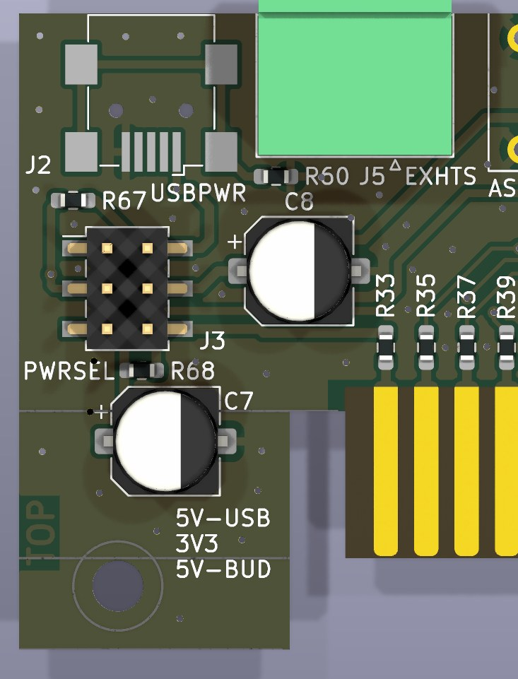

**Alt, Unterseite:** AZ1117 (U2, SOT-223) mit C2–C5

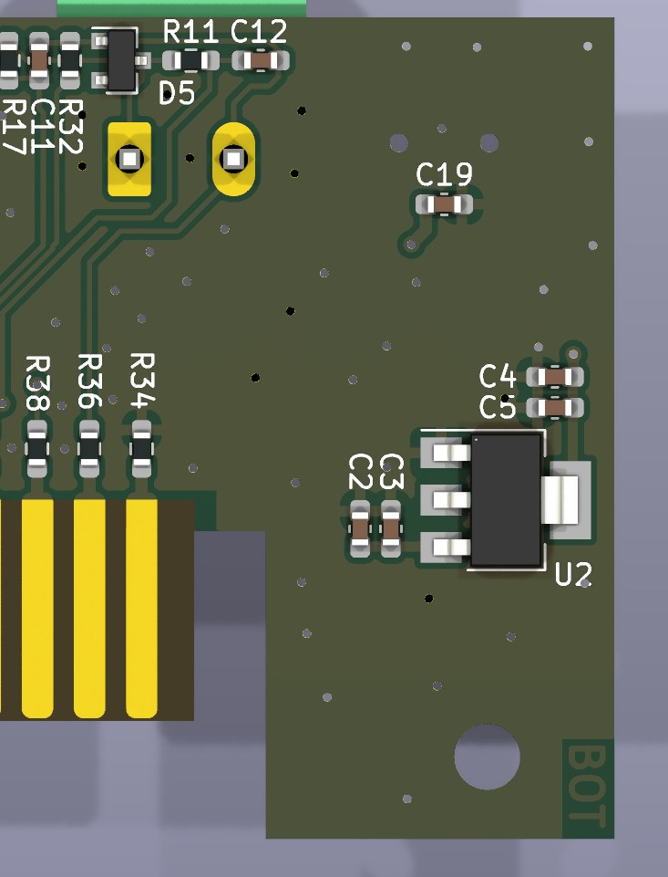

**Neu, Oberseite:** C7/C8 220 µF Polymer, U8 TPS62162 mit L1, C28/C29, D10

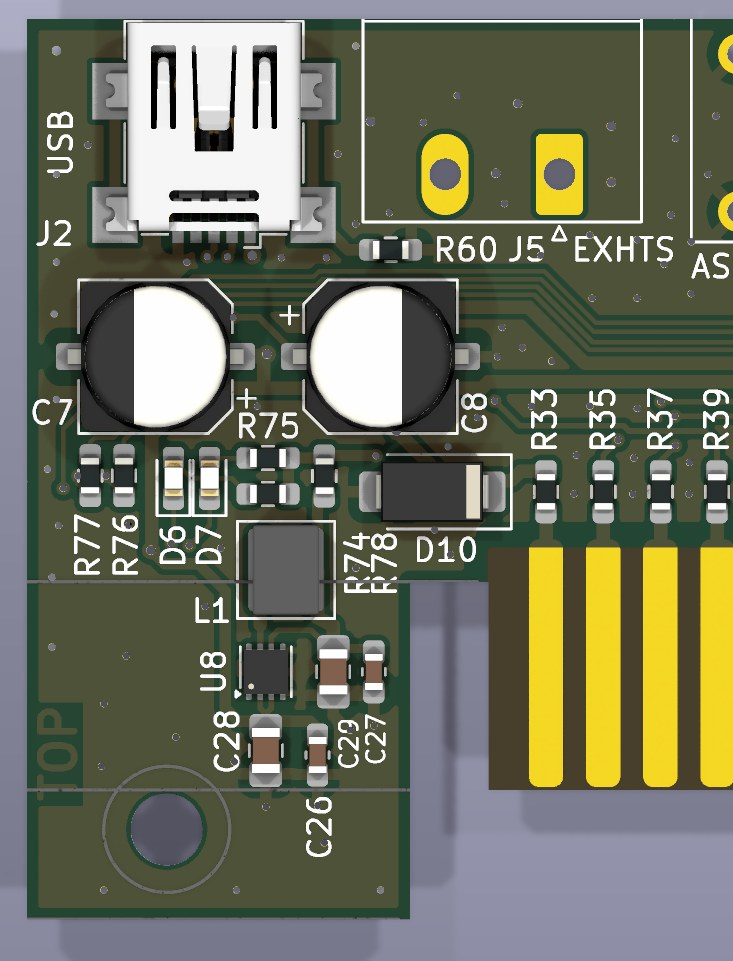

**Neu, Unterseite:** D9 und der Platz für U2 (DNP)

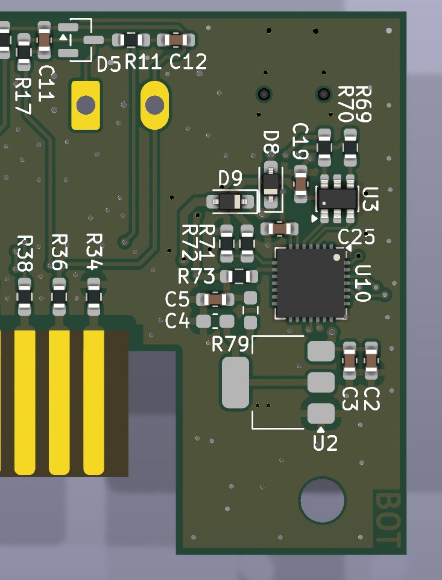

**Gesamtansichten**

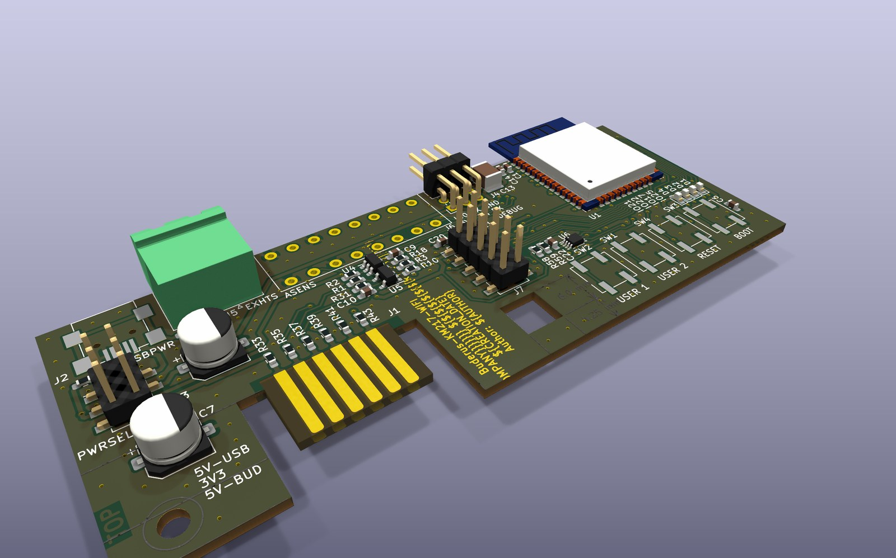

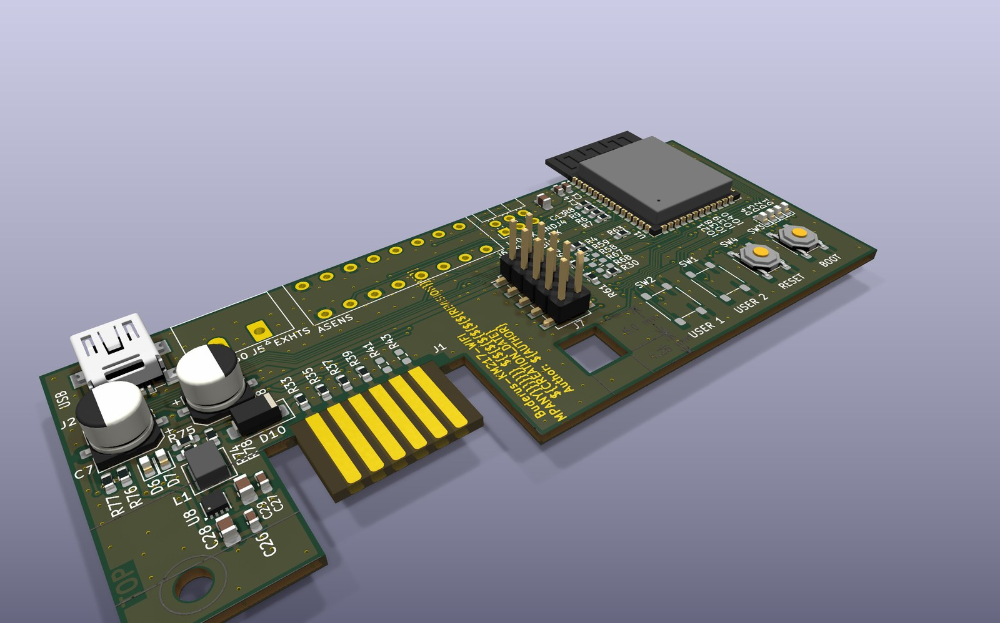
