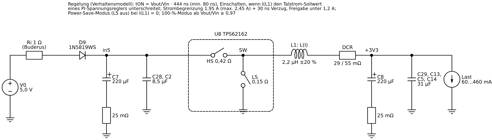
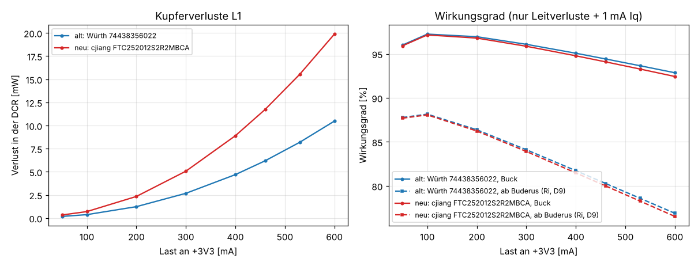

# L1 im 3V3-Wandler: alte gegen neue Speicherdrossel

Diese Seite vergleicht per Simulation die bisherige und die neue Speicherdrossel L1 des Abwärtswandlers U8 (TPS62162, 5 V → 3,3 V). Trotz des Dateinamens geht es um den Step-down-Wandler, einen Step-up-Wandler gibt es auf dem Board nicht.

| | alt | neu |
|---|---|---|
| Typ | Würth WE-MAPI 74438356022 | cjiang FTC252012S2R2MBCA |
| LCSC | C5521727 | C5832372 |
| Bauform | 4,1 × 4,1 × 2,0 mm | 2,5 × 2,0 × 1,2 mm (1008), molded, geschirmt |
| Induktivität | 2,2 µH ±20 % | 2,2 µH ±20 % |
| Isat | 4,05 A | 3,8 A |
| DCR | 29 mΩ | 55 mΩ |
| Preis (JLC) | 1,73 USD | 0,035 USD |

## Ergebnis

- **Im Betrieb sind beide Drosseln praktisch gleichwertig.** Bei 460 mA Dauerlast (ESP32-S3 sendet) unterscheiden sich Rippelstrom (118 / 116 mA Spitze-Spitze), Spitzenstrom (518 / 516 mA) und Ausgangsrippel (0,25 / 0,24 mV) kaum. Die Induktivität sinkt bei 0,52 A nur um 0,5 %.
- **Lastsprung 60 → 460 mA:** Bei beiden Drosseln fällt +3V3 auf 3,290 V und steigt beim Lastabwurf auf 3,311 V. Die Kurven liegen übereinander.
- **Verluste:** Der höhere DCR der neuen Drossel kostet bei 460 mA **11,7 statt 6,2 mW**, also 5,5 mW mehr. Der Wirkungsgrad des Wandlers sinkt dadurch um etwa 0,3 Prozentpunkte (94,1 statt 94,4 % ohne Schalt- und Kernverluste). Ab der Buderus-5V gerechnet (inklusive Ri und D9) sind es 80,0 statt 80,3 %.
- **Kurzschluss mit Strombegrenzung am oberen Datenblattwert (2,45 A):** Der Spulenstrom erreicht bei beiden etwa 2,5 A. Die Induktivität sinkt dabei um 11,5 % (alt) bzw. 13 % (neu). Selbst mit −20 % Toleranz bleiben 1,56 bzw. 1,53 µH. Keine der beiden Drosseln geht in die harte Sättigung.

Die neue Drossel ist damit für diese Anwendung ohne Einschränkung geeignet.

## Simulierte Schaltung



Die Quelle ist dieselbe wie in der [Versorgungsanalyse](Power-Analysis/README.md): Buderus-5V mit 5,0 V Leerlauf und 1 Ω Innenwiderstand, dahinter D9. Die Kondensatoren sind zusammengefasst (Vektorfassung: [schematic_l1.svg](Step-Up-Inductors/schematic_l1.svg)).

| Teil | Modell |
|---|---|
| Quelle | V0 = 5,0 V, Ri = 1 Ω, D9 1N5819WS (IS = 0,2 mA, N = 1,74, RS = 0,2 Ω) |
| Eingang | C7 220 µF Polymer (25 mΩ ESR), C28 + C2 ≈ 8,5 µF effektiv |
| U8 | Schalter HS 0,42 Ω / LS 0,15 Ω (RDS(on) bei ~4,5 V), Verhaltensmodell der DCS-Control-Regelung (siehe Schaltbild) |
| L1 | L(I) = L0 · max(1 − 0,3 · (I/Isat)², 0,2) plus DCR, also −30 % bei Isat |
| Ausgang | C8 220 µF Polymer (25 mΩ ESR), C29, C13, C5, C14 ≈ 31 µF effektiv |
| Last | Stromsenke 60 mA bzw. 460 mA, im Kurzschlussfall 0,1 Ω |

Das Modell schaltet Zyklus für Zyklus und wird mit 1 ns Schrittweite gerechnet. Herstellermodelle werden nicht verwendet. Die Sättigungskennlinie ist angenommen, weil die Datenblätter nur Isat bei 30 % Abfall angeben. Die Form gilt für geformte Metallpulver-Drosseln, die weich sättigen, und beide Drosseln gehören zu dieser Bauart.


Im Betrieb (≈0,6 A) liegen beide Kurven aufeinander. Erst in der Strombegrenzung (≈2,5 A) wird der Unterschied von 4,05 zu 3,8 A Isat sichtbar, und auch dort beträgt er nur etwa 1,5 %.

## Dauerlast 460 mA


| | alt | neu |
|---|---:|---:|
| Eingangsspannung U8 | 4,24 V | 4,24 V |
| Spulenstrom Spitze-Spitze | 118 mA | 116 mA |
| Spitzenstrom | 518 mA | 516 mA |
| Ausgangsrippel | 0,25 mV | 0,24 mV |
| kleinste Induktivität | 2,189 µH | 2,188 µH |

Mit −20 % Induktivität (Toleranzgrenze, gilt für beide Typen gleich) steigt der Rippelstrom um etwa 25 % auf rund 148 mA, und der Spitzenstrom liegt dann bei etwa 0,53 A. Das ist weit unter beiden Isat-Werten. Der sehr kleine Ausgangsrippel ergibt sich aus dem idealisierten Ausgang ohne ESL und Leiterbahnen. Auf der Platine misst man mehr, und zwar für beide Drosseln gleich viel.

## Lastsprung


| | alt | neu |
|---|---:|---:|
| Minimum nach 60 → 460 mA | 3,290 V | 3,290 V |
| Maximum nach 460 → 60 mA | 3,311 V | 3,311 V |
| größter Spulenstrom | 571 mA | 570 mA |

Bei 60 mA arbeitet der Wandler im Power-Save-Modus (lückender Strom). Die Sprungantwort bestimmt der Regler zusammen mit den Ausgangskondensatoren, die Drossel spielt dabei keine Rolle.

## Kurzschluss und Strombegrenzung


Die Strombegrenzung ist auf den oberen Datenblattwert ILIMF = 2,45 A gesetzt. Dazu kommen 30 ns Abschaltverzug. Nach dem Abschalten bleibt der High-Side-Schalter aus, bis der Strom unter 1,2 A gefallen ist.

| | Spitzenstrom | kleinste L | Abfall |
|---|---:|---:|---:|
| alt, L nominal | 2,50 A | 1,95 µH | 11,5 % |
| alt, L −20 % | 2,52 A | 1,56 µH | 11,6 % |
| neu, L nominal | 2,50 A | 1,91 µH | 13,0 % |
| neu, L −20 % | 2,52 A | 1,53 µH | 13,2 % |

Der Spitzenstrom wird von der Strombegrenzung und nicht von der Drossel bestimmt. Beide Drosseln behalten auch hier deutlich mehr als 2/3 ihrer Induktivität, sodass der Strom kontrolliert ansteigt.

## Verluste und Wirkungsgrad



| Last an +3V3 | DCR-Verlust alt | DCR-Verlust neu | Wandler alt | Wandler neu | ab Buderus alt | ab Buderus neu |
|---:|---:|---:|---:|---:|---:|---:|
| 100 mA | 0,4 mW | 0,7 mW | 97,2 % | 97,1 % | 88,1 % | 88,1 % |
| 300 mA | 2,7 mW | 5,1 mW | 96,1 % | 95,9 % | 84,1 % | 83,9 % |
| 460 mA | 6,2 mW | 11,7 mW | 94,4 % | 94,1 % | 80,3 % | 80,0 % |
| 600 mA | 10,5 mW | 19,9 mW | 92,9 % | 92,4 % | 76,9 % | 76,5 % |

Gerechnet sind nur die Leitverluste in DCR und Schaltern sowie 1 mA Eigenstrom, ohne Schalt-, Gate- und Kernverluste. Die absoluten Wirkungsgrade liegen deshalb etwas zu hoch, für den Vergleich der Drosseln ist das unerheblich. Die Kernverluste hängen vom Material ab und sind in keinem der Datenblätter für 2,25 MHz angegeben. Ab etwa 0,65 A geht der Wandler bei Ri = 1 Ω in den 100-%-Modus, weil die Buderus-Spannung zu weit einbricht. Deshalb endet die Kurve bei 600 mA.

Der Mehrverlust von 5,5 mW bei 460 mA ändert den Strom aus der Buderus um etwa 1,3 mA und die Spannung im 100-%-Modus um etwa 12 mV.

## Reproduzieren

```bash
cd DOC/Step-Up-Inductors
python3 sim.py        # Plots, Zahlen auf stdout (numpy, matplotlib, ~10 s)
python3 schematic.py  # Schaltbild als SVG (schemdraw); das PNG ist daraus gerendert
```
